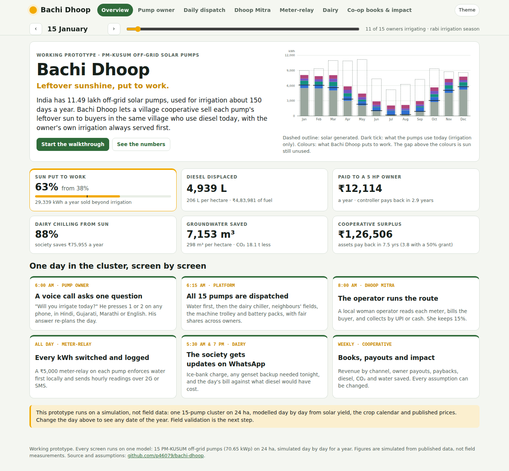
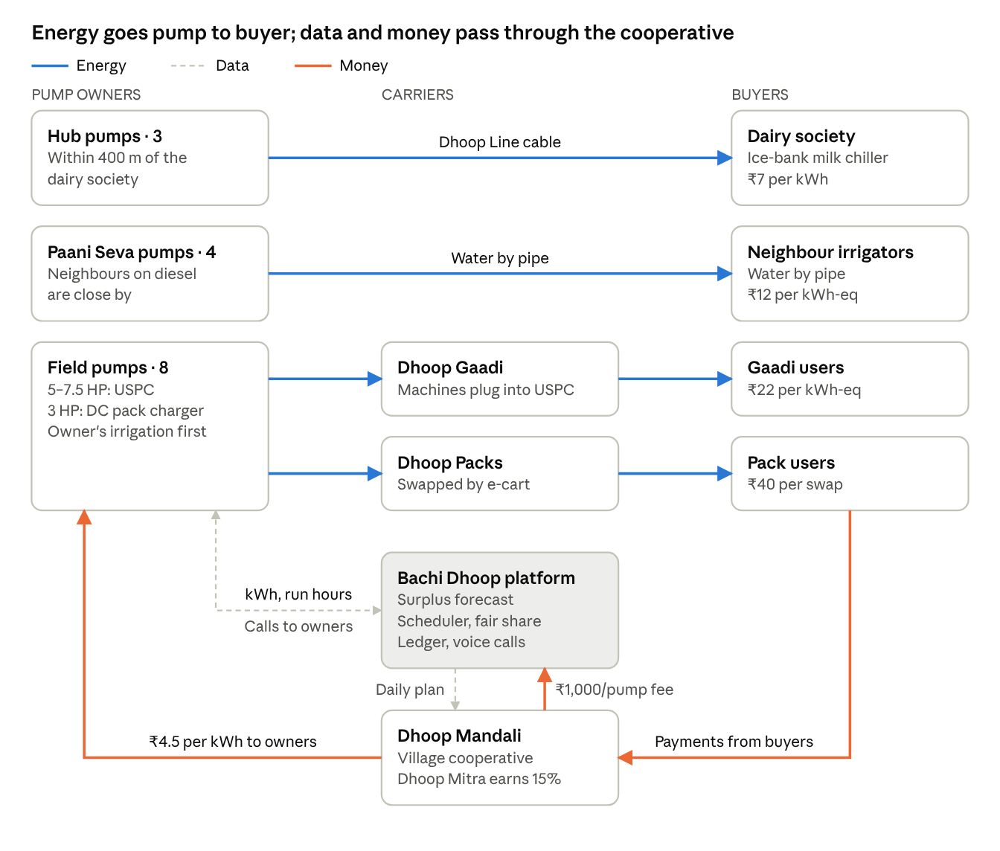

# Bachi Dhoop · Leftover sunshine, put to work

**Live prototype:** https://p46079.github.io/bachi-dhoop/

India has installed **11.49 lakh off-grid solar pumps** under PM-KUSUM (Component B). A farmer needs his pump for irrigation about 150 days a year, so most of its sunshine is wasted, while the same village buys diesel at ₹98 a litre to chill milk, pump water and run machines.

**Bachi Dhoop** lets a village cooperative sell each pump's leftover sun to buyers in the same village, with the owner's own irrigation always served first:

| Channel | Buyer | Price |
|---|---|---|
| **Dhoop Line** | Dairy society's ice-bank milk chiller, by a short cable | ₹7 / kWh |
| **Paani Seva** | Neighbours who rent diesel pumps today | ₹12 / kWh-eq |
| **Dhoop Gaadi** | Dairy households, via a machine trolley (chaff cutter, pulveriser) | ₹22 / kWh-eq |
| **Dhoop Packs** | Homes and shops, via 2.4 kWh swappable batteries | ₹40 / swap |

Built for the **Schneider Electric Yuva Yodha Energy Tech Hackathon**, Sustainable Agriculture track (energy, water, productivity).



## What the prototype does

One engine simulates a 15-pump, 24 ha cluster day by day for a year. Six screens show how each person uses the system:

| Screen | Who | What you can do |
|---|---|---|
| **Pump owner** | Farmer with a KUSUM pump | Answer the 6 am voice call (press 1 or 2) in Hindi, Gujarati, Marathi or English and hear it played; see how the answer re-plans the day; hear the 7 pm earnings call; see weekly earnings |
| **Daily dispatch** | Platform / cooperative | See all 15 pumps for any day: water first, then dairy, neighbours, Gaadi, packs, with fair-share rotation explained |
| **Dhoop Mitra** | Local woman operator | Follow the day's route, enter meter readings, bill each buyer, mark UPI / cash / monthly bill, track her 15% commission |
| **Meter-relay** | The ₹5,000 box on each pump | Play a pump's day hour by hour: relay state, energy counters, and the packet it sends over 2G/SMS |
| **Dairy** | Milk society secretary | WhatsApp-style updates: ice-bank charge, genset backup needed, daily bill and savings; quick replies |
| **Co-op books & impact** | Cooperative, judges | Revenue, payouts, paybacks by party, diesel, CO₂ and water saved; change any assumption with sliders |

## Key results (simulation)

| Metric | Today | With Bachi Dhoop |
|---|---|---|
| Solar output put to work | 37% | **62%** |
| Diesel displaced, per cluster a year | – | **5,049 L** |
| CO₂ avoided, per cluster a year | – | **18.5 t** |
| Groundwater saved, per cluster a year | – | **6,900 m³** |
| Income to a 5 HP pump owner | ₹0 | **₹12,492 / year** |
| Whole-cluster payback (₹16.8 lakh of assets) | – | **3.3 years** |

These are results of the Python model, a calibrated simulation, not field measurements. The browser app runs the same logic with a different random-number generator, so its figures differ by up to about 4%. Sources and assumptions: [docs/data-sources.md](docs/data-sources.md).

## Architecture



- **Field:** the KUSUM pump and its mandatory remote monitoring unit, plus a ₹5,000 meter-relay per pump (energy meter, two-way relay, 2G/SMS modem) that enforces water first locally.
- **Platform:** forecasts surplus, dispatches channels by priority and fair share, keeps the metered ledger, places voice calls and settles weekly payouts.
- **Cooperative:** the Dhoop Mandali owns shared assets; a Dhoop Mitra operator runs the daily route for a 15% commission.

## Repository

```
index.html            App shell (static, no build step)
app/engine.js         Dispatch and economics engine (browser port of the Python model)
app/app.js            The six screens
app/i18n.js           Voice-call and SMS scripts in Hindi, Gujarati, Marathi, English
app/styles.css
model/                Python simulation: bachi_dhoop_sim.py and its results
tests/                Engine checks against the Python results and dispatch rules
docs/                 Architecture, data sources, screenshots
```

## Run it

**In a browser:** open the live link above, or serve the folder locally:

```bash
python3 -m http.server 8000      # then open http://localhost:8000
```

**The Python model** (365-day simulation, sensitivity and 50-seed robustness):

```bash
cd model
pip install -r requirements.txt
python3 bachi_dhoop_sim.py       # writes model/results/sim_results.json
```

**Tests** (Node 18+):

```bash
node tests/engine.test.mjs
```

The tests check the browser engine against the Python model, and that dispatch never sells more than a pump generates, always obeys the owner's 6 am answer, and logs every kWh.

## Technology

- HTML, CSS and JavaScript (ES modules), no framework and no build step; hosted on GitHub Pages
- Python 3 with NumPy for the simulation model
- Web Speech API for playing voice calls in Indian languages (uses the device's voices)
- Planned for the field pilot: ESP32-class meter-relay with energy metering IC and 2G/SMS modem; IVR provider for voice calls; UPI for payouts; WhatsApp Business API for the dairy

## Team

Ananta Sharma, Institute of Rural Management Anand (IRMA) · p46079@irma.ac.in

## License

MIT, see [LICENSE](LICENSE).
